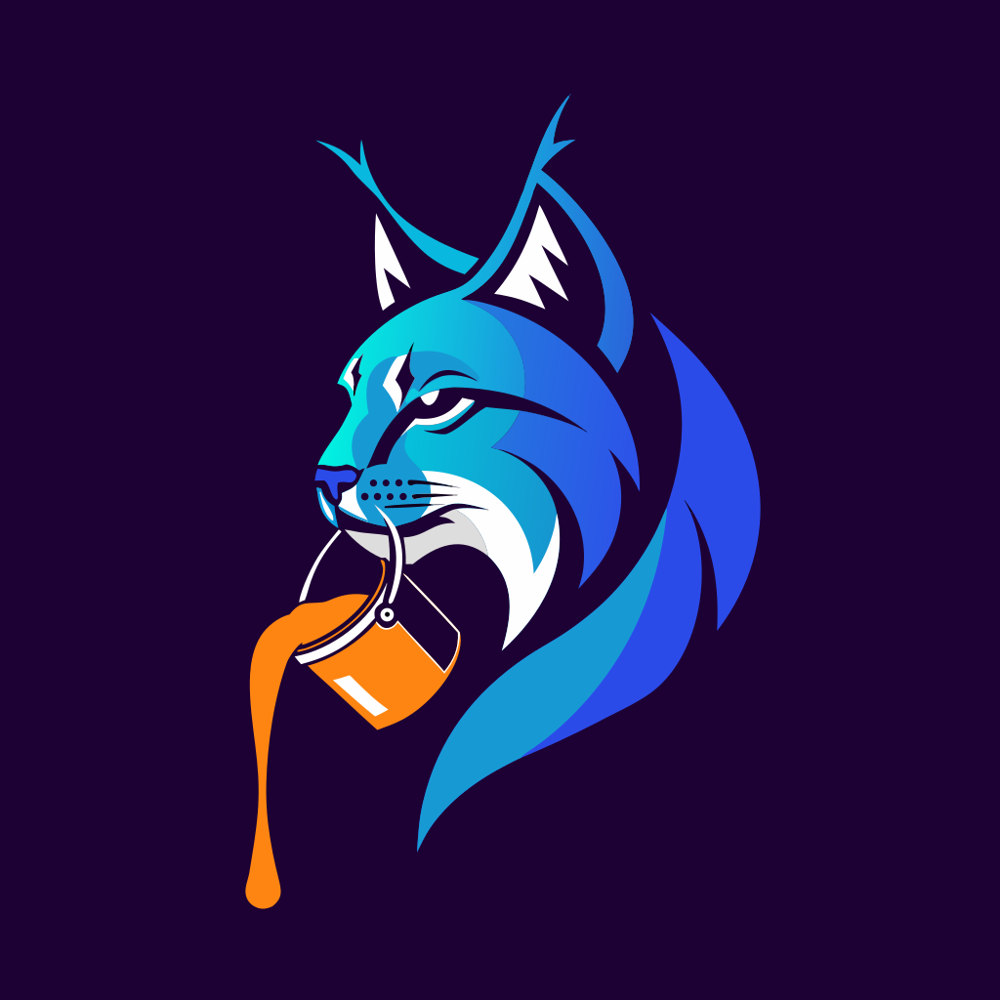
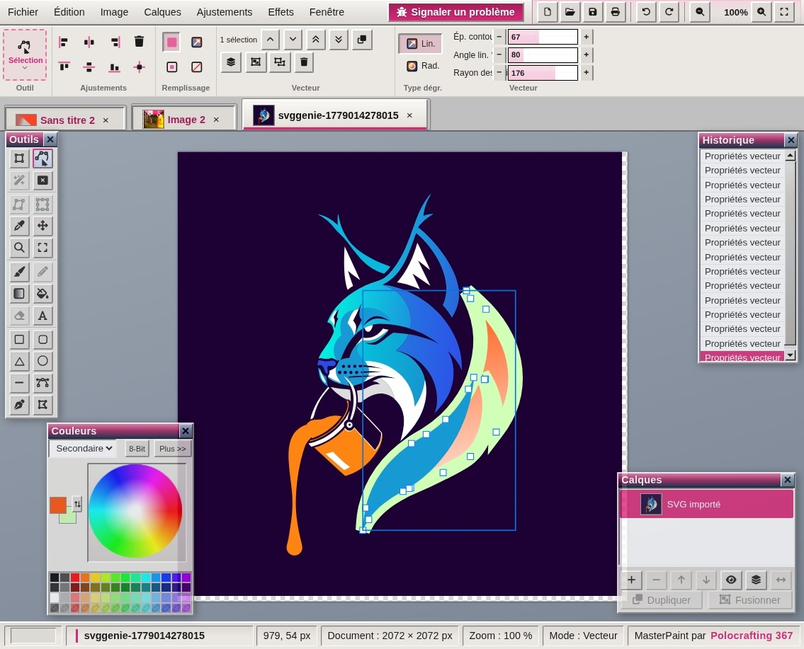
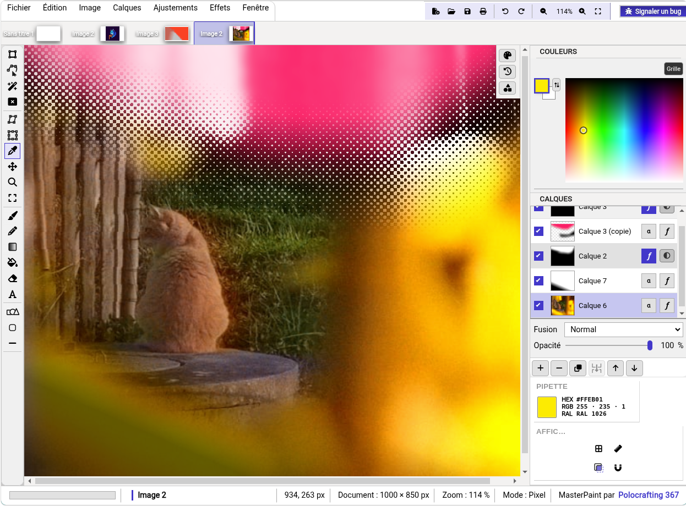
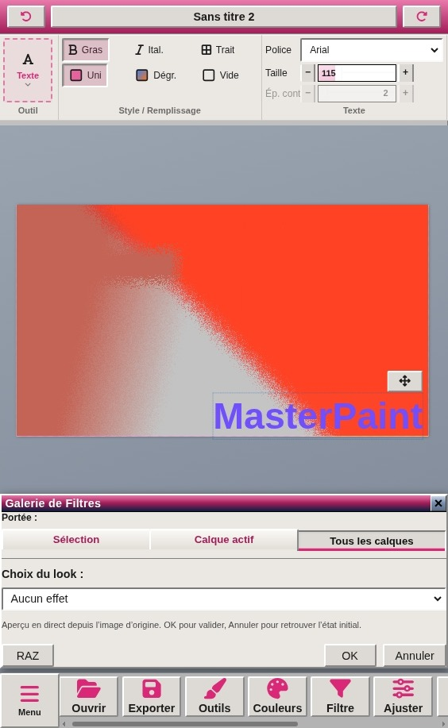

<!-- MasterPaint — © 2026 polocrafting — https://polocrafting.fr. Voir COPYRIGHT.md / See COPYRIGHT.md. -->

  <a href="http://masterpaint.fr"><strong>▶ Démo en ligne</strong></a>
  &nbsp;·&nbsp; Projet indépendant &nbsp;·&nbsp; 100 % local &nbsp;·&nbsp; Thème Win98 Modern

  

<h1 align="center">MasterPaint 98</h1>

  
  &nbsp;
  
  &nbsp;
  

  <strong>Mise en page type Paint.NET</strong>
  &nbsp;&nbsp;|&nbsp;&nbsp;
  <strong>Colonnes ancrées : type Photoshop</strong>
  &nbsp;&nbsp;|&nbsp;&nbsp;
  <strong>Menu ☰, ajusté pour téléphone</strong>

---

## Structure du dépôt

| Dossier | Contenu |
|---|---|
| `index.html`, `rust-app/` | Version navigateur (Rust + Slint) — page d'accueil du site |
| `rust/` | Code : `masterpaint-ui` (interface), `masterpaint-core` (moteur d'effets), `packaging` (icônes et fichiers de paquets), `build-all.sh` |
| `icons/`, `IMG/`, `fonts/` | Ressources du site et de l'application |
| `downloads/` | Applications compilées (Windows, Linux) |
| `docs/` | Liste de travail et notes techniques |

Compilation : `rust/build-all.sh [web|linux|flatpak|windows|apk]`.

## À propos

**MasterPaint** s’inspire de **Paint.NET**, **Photoshop** et **Illustrator**. Créez des images bitmap et vectorielles au même endroit, sans publicité ni traceurs. Tout fonctionne à **100 % en local** : le navigateur peut utiliser `localStorage` et IndexedDB pour une sauvegarde temporaire sur votre machine.

## Thèmes de l’interface

Choisissez une présentation dans **Paramètres → Apparence → Thème de l’interface** :

- **MasterPaint** — ruban complet et palettes personnalisables, finition Moderne ou Windows 98.
- **Paint.NET** — présentation paintdotjs, barre compacte, ordre des outils et palettes flottantes.
- **Photoshop** — présentation PhotoCraft, outils à gauche et panneaux ancrés à droite.
- **Téléphone** — commandes tactiles, menu compact et panneaux escamotables.

Le moteur, les effets et les outils restent ceux de MasterPaint. Le retour au thème MasterPaint retrouve les réglages de son ruban, de sa disposition et de sa finition.

L’onglet **Icônes** propose les packs **MasterPaint**, **PaintJS**, **PhotoCraft** et les packs importés, indépendamment du thème. Chaque pack affiche un aperçu et propose activation, export JSON ou ZIP avec icônes exportées en PNG, ou suppression. [Format des packs et détails](docs/interface-packs.md).

## Fonctionnalités

- **Formes et calques** — Bitmap et vectoriel, calques et formes modifiables
- **Dessin** — Pinceau, crayon, gomme, pot de peinture, dégradé
- **Effets** — Filtres, effets dynamiques sur calques, accélération carte graphique (WebGPU, WebGL) et WebAssembly
- **Outils** — Déformation, perspective, sélection et alignement
- **Interface** — Trois dispositions (voir captures ci-dessus)

## Démarrage

**En ligne** — [masterpaint.fr](https://masterpaint.fr)

**En local** — Téléchargez le ZIP du projet, lancez XAMPP (ou tout serveur web local) et ouvrez l’application dans le navigateur.

---

  Application développée par <a href="https://polocrafting.fr">polocrafting</a>

## Thèmes, packs et crédits

Quatre présentations sont disponibles dans **Paramètres → Apparence** : MasterPaint, Paint.NET, Photoshop et Téléphone. Dans **Paramètres → Icônes**, importez JSON, ZIP, PNG, JPG/JPEG ou SVG, puis exportez chaque pack en JSON ou en ZIP. Les icônes du pack exporté sont fournies en PNG. Voir [le format et les réglages](docs/interface-packs.md).

**MasterPaint est développé par polocrafting — [polocrafting.fr](https://polocrafting.fr).** Les crédits et conditions de réutilisation sont détaillés dans [COPYRIGHT.md](COPYRIGHT.md) et dans **Paramètres → Crédits**. Les ressources tierces conservent leurs licences propres.
